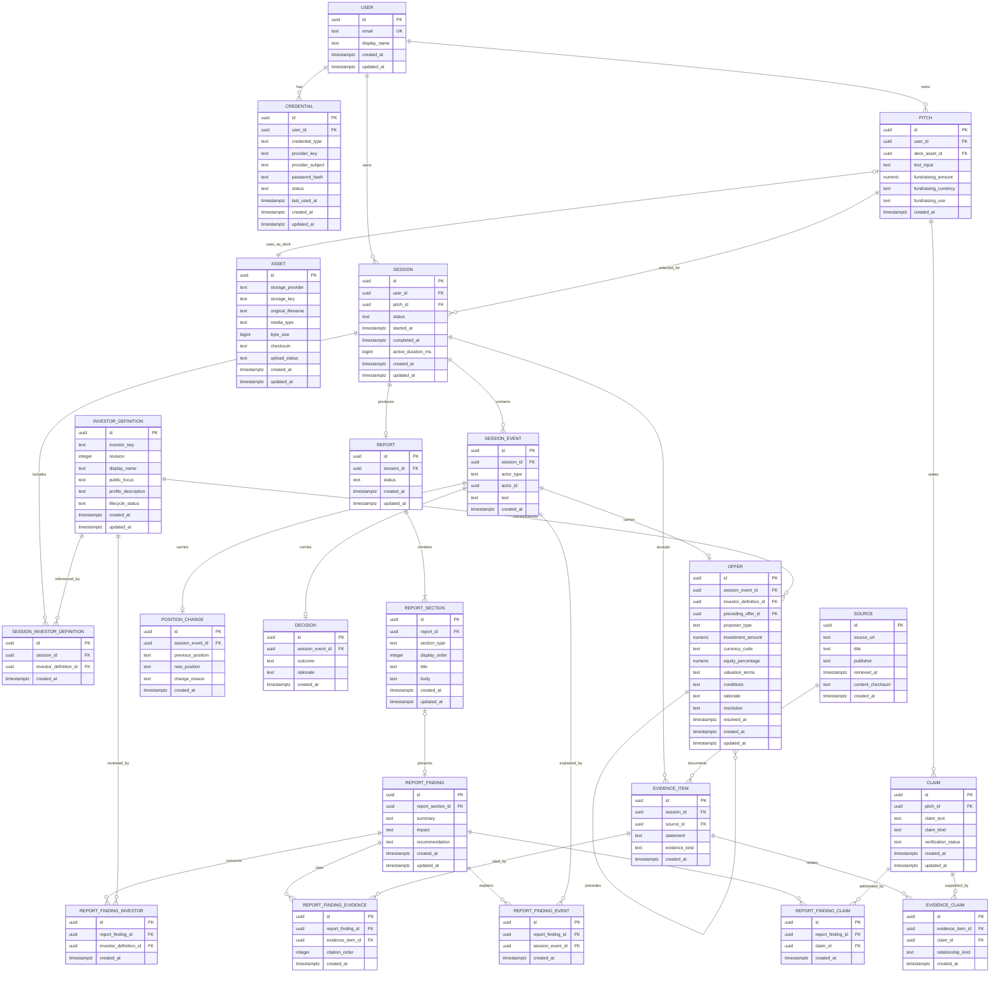

# Turing Tank Data Model

## Purpose

This document defines the relational domain model for Turing Tank. It describes the records the application keeps, the relationships between them, and the rules that protect their meaning.

The model separates founder input, sourced evidence, investor reasoning, negotiation, and reporting. It keeps durable application data independent from workflow checkpoints and agent implementation details.

The field names below use PostgreSQL's lowercase `snake_case` convention. Each table has a UUID `id` primary key and a `created_at` timestamp. Mutable tables also have an `updated_at` timestamp. Relationship fields use UUIDs rather than display names, registry keys, or other text values.

## Relational Model

The diagram shows the domain tables and the physical join tables needed to represent many-to-many relationships. The join tables are persistence records, not additional domain concepts.

## Identity

`User` represents the person using the product. Every user has one required email address, and email is unique across users. The user owns pitches and sessions. Profile metadata belongs on the user record rather than in a separate profile entity.

`Credential` represents one way for a user to authenticate. A password credential stores a one-way password hash. An external provider credential stores its provider key and provider subject. These authentication variants use separate credential rows when one user supports more than one method. A credential does not duplicate the user's email.

The credential type determines which authentication fields are valid. A password credential has a `password_hash` and no provider subject. An external provider credential has both `provider_key` and `provider_subject` and no password hash. The pair of provider fields is unique.

## Pitches, Assets, and Claims

`Pitch` is a reusable input package for one idea. It contains the required fundraising amount and intended use, plus at least one of `text_input` or `deck_asset_id`. A session selects one pitch, and the same pitch can be selected by independent sessions.

A pitch record is immutable. A revised pitch is represented by another pitch record without a predecessor link. This keeps each session tied to the exact input that was used without creating a pitch revision model.

`Asset` represents a file stored outside the database. It keeps the object-storage location and file metadata needed to retrieve and validate the file. It does not store the file contents or a permanent access URL. The pitch owns the asset relationship, so the asset does not repeat `user_id`.

`Claim` represents a meaningful assertion made in a pitch. Claims belong to the pitch and give research a focused subject. A claim can remain unverified when research does not produce a reliable source.

## Sessions and Investors

`Session` is the durable record of one rehearsal. It belongs to one user, selects one pitch, and stores lifecycle and active-time information for the rehearsal.

The session panel is represented by `session_investor_definitions`. This is a physical join table rather than a separate domain entity. It contains three distinct UUID references to `InvestorDefinition`. It stores membership only. Runtime questioning and negotiation order are not persisted in the panel membership record.

`InvestorDefinition` is a registry record for an investor implementation. It has a UUID identity, an `investor_key`, a revision, public display metadata, and lifecycle status. The pair of `investor_key` and `revision` is unique. A new definition revision is a new row, and a retired definition remains addressable by sessions that used it.

Prompts, behavior rules, internal thresholds, and investor-owned tools do not belong in the persistence model. The registry and investor modules own those details.

## Evidence and Sources

`Source` records the provenance of an external reference. `EvidenceItem` records a factual statement accepted into a session. Evidence is shared across the panel, even when one investor initiated the research.

`evidence_claims` links evidence to claims. The relationship is many-to-many because one source statement can support or challenge several claims, and a claim can have several supporting or contradictory evidence items. `relationship_kind` describes whether the evidence supports, challenges, or otherwise relates to the claim.

Failed searches and raw provider responses are not durable domain records. Only accepted evidence with enough provenance for inspection and citation enters the session model.

## Session Events and Reasoning

`SessionEvent` is the chronological record of one meaningful exchange in a session. It stores the session, an actor reference, optional text, and its creation time. `actor_type` identifies whether `actor_id` refers to a user or an investor definition. The actor reference is a typed UUID reference. Events are ordered by their creation time rather than by a separate conversation or turn model.

`PositionChange` is a dependent detail of a session event. It records an investor's previous position, new position, and reason for changing. The reason can be a founder's argument, external evidence, or the investor's own assessment. A position change does not require an evidence record.

`Decision` is a dependent detail of a session event. It records an investor's final outcome and rationale. It is separate from a position change because an investor can change position during questioning without reaching a final decision.

The event text and dependent details together preserve the exchange. The model does not introduce separate question, answer, statement, message, or turn entities.

## Offers and Negotiation

`Offer` is a dependent detail of a session event. It records one proposed set of deal terms, the investor context, the proposer type, the rationale visible to the founder, and its resolution.

Every offer has an `investor_definition_id` because the negotiation remains associated with one investor even when the founder is the proposer. `proposer_type` distinguishes an investor proposal from a founder proposal. A founder proposal uses the user who owns the session as its proposer without adding a polymorphic proposer foreign key.

`preceding_offer_id` links a counteroffer to the offer it answers. A counteroffer is another offer record with its own terms. The negotiation rule that permits at most one investor to receive a second turn is enforced by session behavior rather than by adding response or counteroffer entities.

Offer terms do not change after creation. Resolution fields can change to record acceptance, rejection, or a countered state. A session can finish without any offer.

## Reports and Findings

`Report` belongs to one session. Each session has one report. A report can contain complete or partial debrief content, and its sections can be appended or updated in place.

`ReportSection` is an ordered presentation record. Its section type is one of `summary`, `finding`, `investor_review`, `negotiation`, or `practice_plan`. A finding section presents one `ReportFinding`, but other sections do not need a finding.

`ReportFinding` is an issue-focused conclusion for the founder. It can address multiple claims, cite selected evidence, reference the session events that explain the conclusion, and apply to one or more investors. A finding without investor links applies to the panel as a whole.

The report exposes only the facts and evidence that support its findings. It does not expose every research result, provider response, or internal reasoning record.

## Ownership and Data Access

User-owned records are protected by row-level security. Directly owned tables carry the user relationship needed to establish ownership. Descendant records enforce access through their pitch, session, report, or join-table relationships rather than copying `user_id` onto every table.

The main ownership paths are:

- `users` owns `pitches` and `sessions`.
- `pitches` owns `claims` and its deck `asset`.
- `sessions` owns evidence, session events, and the panel membership.
- `sessions` owns its `report`, which owns report sections and findings.

`investor_definitions` is registry-owned rather than user-owned. `sources` are provenance records used by session evidence. Access to user-specific evidence remains governed through the owning session.

## Model Boundaries

The domain model stores the accepted records that describe a pitch, a session, its reasoning, its negotiation, and its report. Workflow execution details remain separate. Graph checkpoints, nested investor state, prompts, behavior contracts, tool definitions, and model-provider details support execution without replacing those durable records.
